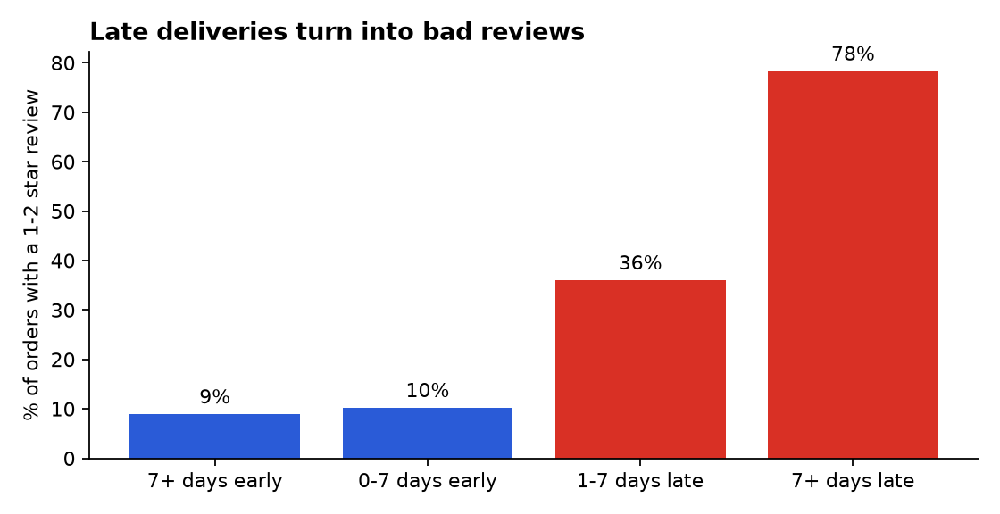
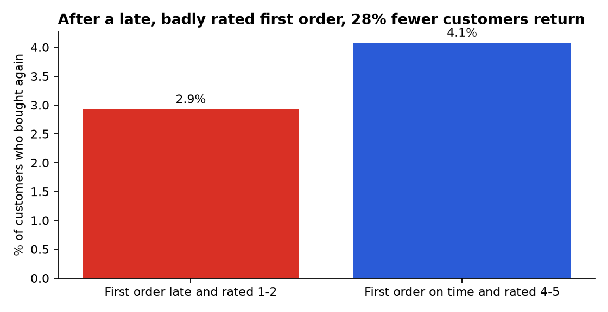

# Olist: what drives bad reviews and lost customers?

**SQL + Python analysis of 96k real e-commerce orders, ending in a one-page recommendation memo.**



## The business question
Olist is a Brazilian marketplace. One in eight delivered orders gets a 1–2 star review, and only 3% of customers ever buy again. What drives those bad reviews, what can the company control, and where should it act first?

👉 **Read the conclusions in [MEMO.md](MEMO.md)** (1 page, written for a Head of Operations).

## Key findings
- **Late deliveries drive bad reviews.** 9% of early orders get a bad review, against 36% of orders 1–7 days late and 78% of orders more than 7 days late.
- **Delays are regional.** 14–20% of orders arrive late in MA, CE, BA and RJ, against 5–6% in SP, MG and PR.
- **Customers rarely return (3%), and after a bad first order even fewer do.** Repurchase is 2.9% after a late, badly rated first order and 4.1% after a good one (z = 3.2, correlational).
- **Bad reviews can't be predicted well at purchase time** (AUC 0.61). With the delivery delay known, the model reaches AUC 0.71. The fix is operational.



## How it's built

| Step | File | What it does |
|---|---|---|
| 1 | `data/download_data.py` | Downloads the 7 tables from [Olist's public repository](https://github.com/olist/work-at-olist-data) |
| 2 | `src/build_database.py` | Loads them into SQLite with indexes |
| 3 | `sql/00_delivered_orders.sql` | One clean view of delivered orders (joins, dates, delays, reviews) |
| 4 | `sql/01…05_*.sql` | One file per business question: KPIs, delay vs reviews, first experience vs repurchase, states, categories |
| 5 | `src/run_analysis.py` | Runs the SQL, saves `results/*.csv`, draws the charts |
| 6 | `src/model.py` | Bad-review prediction (logistic regression vs gradient boosting, time-based split) and a significance test |
| 7 | `MEMO.md` | Findings turned into four recommendations |

SQL techniques used: CTEs, views, window functions (`ROW_NUMBER`, `COUNT OVER`), conditional aggregation, multi-table joins.

## Run it

```bash
pip install -r requirements.txt
python data/download_data.py
python src/build_database.py
python src/run_analysis.py
python src/model.py
```

## Data
Brazilian E-Commerce Public Dataset by Olist, CC BY-NC-SA 4.0. The raw data is not stored in this repository; the download script fetches it.

---
Built by **Manuel Portugal Reis** · [LinkedIn](https://www.linkedin.com/in/manuelportugalreis/)
